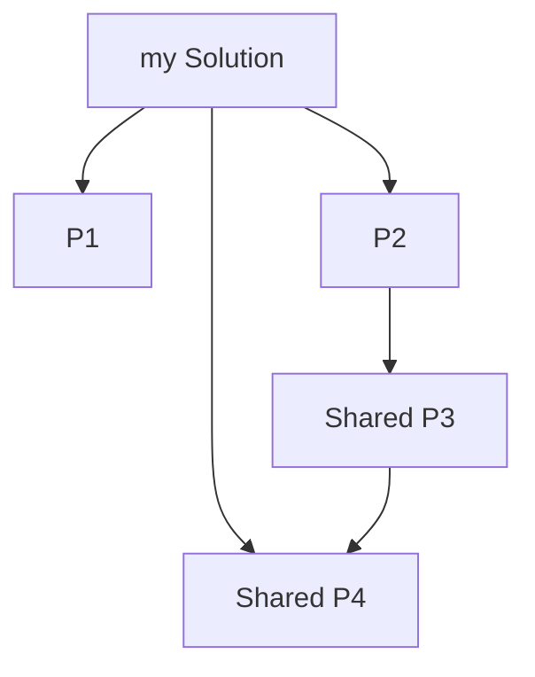
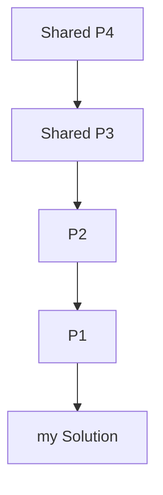
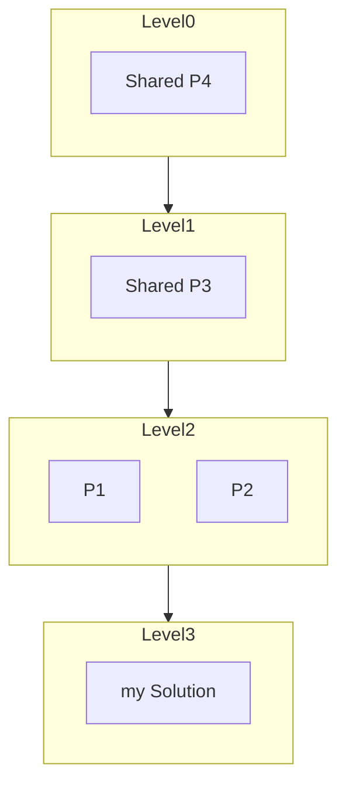
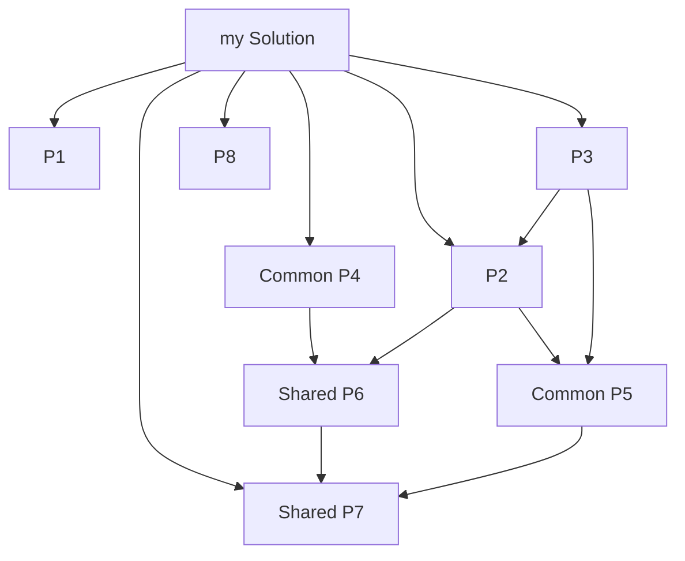
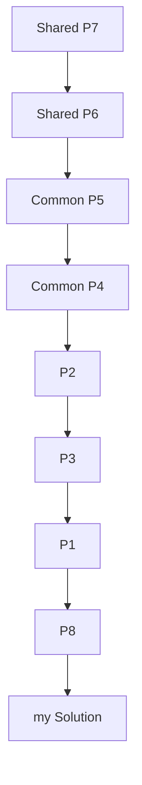
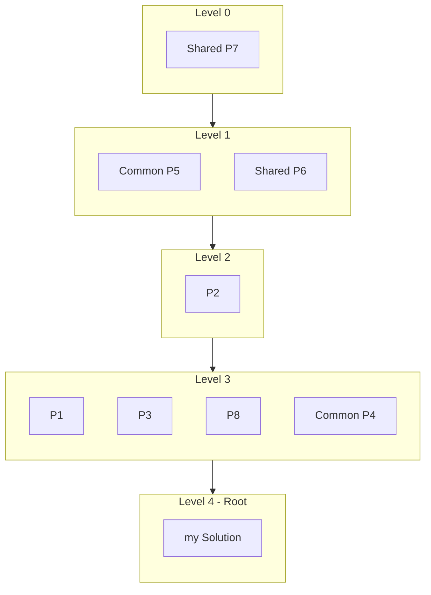

<div align="center">


# DeeplyDepBuilder

Visualize .NET project dependencies and build independent projects in parallel.

[](https://www.nuget.org/packages/CodersTea.DeeplyDepBuilder)
[](https://www.nuget.org/packages/CodersTea.DeeplyDepBuilder)
[](https://dotnet.microsoft.com/)
[](LICENSE)

</div>

## Table of contents

- [Overview](#overview)
- [Features](#features)
- [Installation](#installation)
  - [Via NuGet](#via-nuget)
  - [From source](#from-source)
- [Usage](#usage)
  - [CLI options](#cli-options)
  - [Examples](#examples)
- [Dependency graph examples](#dependency-graph-examples)
  - [Simple example](#simple-example)
  - [Complex example](#complex-example)
- [Roadmap](#roadmap)
- [License](#license)

## Overview

`dotnet build` builds project references by default. DeeplyDepBuilder adds dependency visualization and level-based parallel execution.

The tool parses your solution or project references, flags circular dependencies, and groups projects into discrete levels with a topological sort. Projects within the same level have no dependencies on each other and build in parallel. You can also export the dependency tree as a Mermaid diagram.

Build time comparisons against standard `dotnet build` are not yet benchmarked.

## Features

- Cycle detection to catch circular references before building.
- Mermaid graph export to Markdown for project trees and topological levels.
- Level-based topological sort so independent projects build concurrently.
- Clean command that runs `dotnet clean` across the entire resolved tree.
- Option to display file names instead of full paths in graphs.

## Installation

### Via NuGet

Install the tool globally:

```bash
dotnet tool install --global CodersTea.DeeplyDepBuilder
```

Package details are on [NuGet](https://www.nuget.org/packages/CodersTea.DeeplyDepBuilder).

### From source

```bash
git clone https://github.com/Shaikh-Imran/DeeplyDepBuilder.git
cd DeeplyDepBuilder
dotnet build DeeplyDepBuilder.sln
dotnet tool install --global --add-source ./nupkg CodersTea.DeeplyDepBuilder
```

## Usage

Pass a solution or project path:

```bash
deeplydep -p /path/to/solution.sln
```

To run directly from source:

```bash
dotnet run --project DeeplyDepBuilder.csproj -- -p /path/to/solution.sln
```

### CLI options

| Option | Short | Default | Description |
|---|---|---|---|
| `--project` | `-p` | None (required) | Path to `.csproj` or `.sln` |
| `--clean` | `-c` | `false` | Run `dotnet clean` instead of `dotnet build` |
| `--generate-graph-path` | `-g` | None | Write a Markdown file with Mermaid diagrams to this path |
| `--hide-path-in-graph` | | `false` | Show file names instead of full paths in graphs |
| `--no-parallel` | | `false` | Build projects sequentially instead of in parallel |
| `--show-build-output` | | `false` | Print `dotnet` build output to the console |
| `--verbose` | `-v` | `false` | Print trace logs |
| `--help` | | | Show help text |
| `--version` | | | Show version |

### Examples

Build a project:
```bash
deeplydep -p /path/to/project.csproj
```

Clean all projects in the dependency graph:
```bash
deeplydep -p /path/to/solution.sln -c
```

Generate a Mermaid graph file and build:
```bash
deeplydep -p /path/to/solution.sln -g /path/to/output/graph.md
```

Build sequentially and print build output:
```bash
deeplydep -p /path/to/solution.sln --no-parallel --show-build-output
```

## Dependency graph examples

Test solution: [dotnet-mono-repo-example](https://github.com/Shaikh-Imran/dotnet-mono-repo-example) (for cycle detection, see the [`cyclic-dep`](https://github.com/Shaikh-Imran/dotnet-mono-repo-example/tree/cyclic-dep) branch).

### Simple example

#### Project structure


#### Topological sort


#### Topological sort with levels


### Complex example

#### Project structure


#### Topological sort


#### Topological sort with level groups


## Roadmap

- [x] Graph visualization
- [x] Graph cycle detection
- [x] Graph level grouping
- [x] Parallel build by level
- [x] Clean build
- [ ] Skip build if project is up to date
- [ ] Shorten paths in graph output
- [ ] Terminal-based graph visualization

## License

[MIT](LICENSE)
