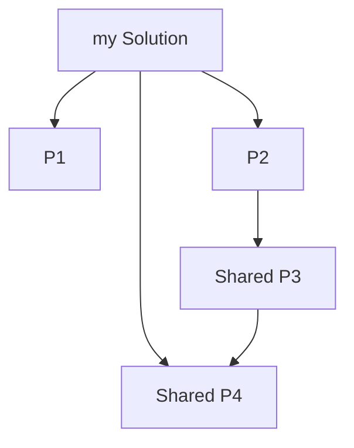
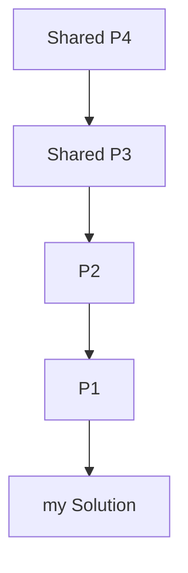
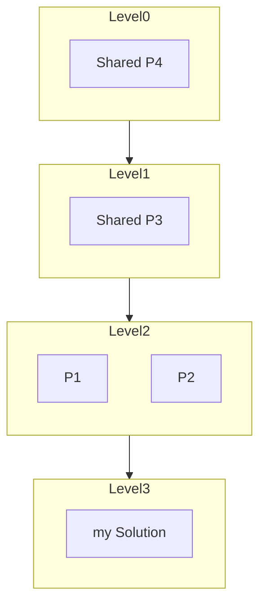
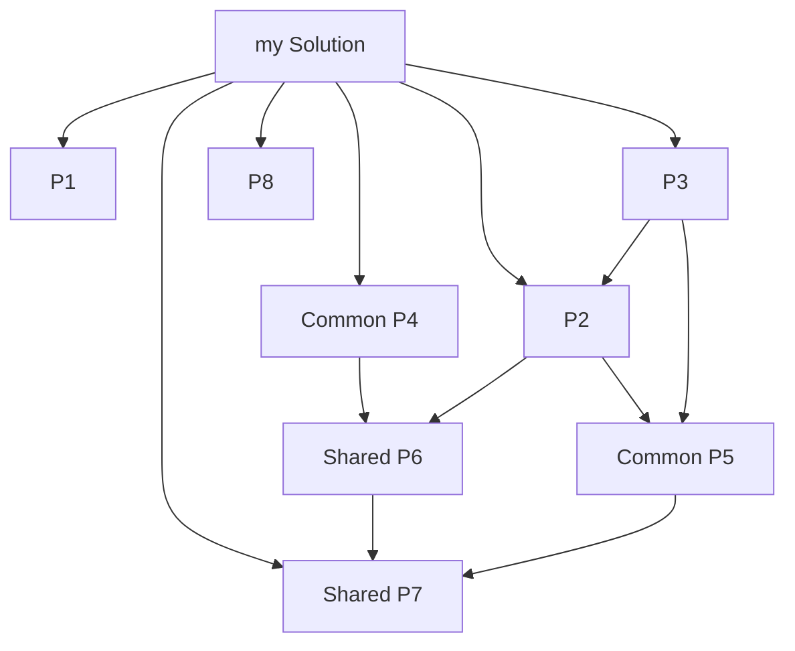
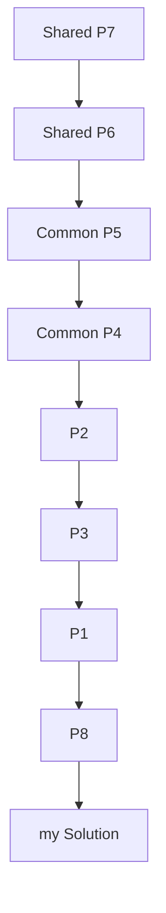
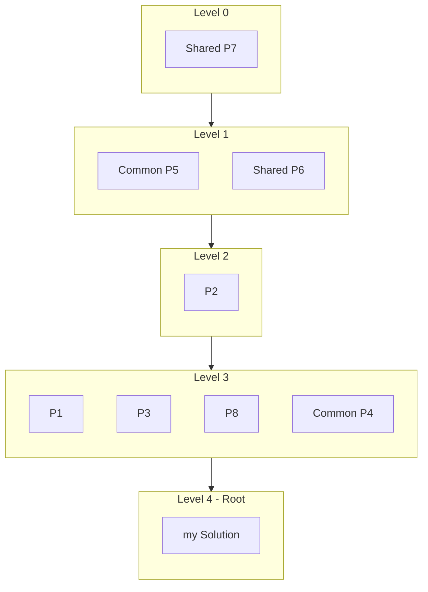

<div align="center">


# DeeplyDepBuilder

CLI tool to visualize .NET dependency graphs and build independent project levels in parallel.

[](https://www.nuget.org/packages/CodersTea.DeeplyDepBuilder)
[](https://www.nuget.org/packages/CodersTea.DeeplyDepBuilder)
[](https://dotnet.microsoft.com/)
[](LICENSE)

</div>

## Table of Contents

- [Overview](#overview)
- [Features](#features)
- [Installation](#installation)
  - [Via NuGet](#via-nuget)
  - [From Source](#from-source)
- [Usage](#usage)
  - [CLI Options](#cli-options)
  - [Common Commands](#common-commands)
- [Dependency Graph Examples](#dependency-graph-examples)
  - [Simple Example](#simple-example)
  - [Complex Example](#complex-example)
- [Roadmap](#roadmap)
- [License](#license)

---

## Overview

DeeplyDepBuilder analyzes the complete project reference dependency graph of a .NET solution or project.

While `dotnet build` automatically resolves and builds project references, understanding deep dependency chains across large solutions or monorepos remains challenging. DeeplyDepBuilder addresses this by:

- **Visualizing Dependency Graphs**: Generates Mermaid diagrams illustrating project relationships, topological order, and level groupings.
- **Level-Parallel Builds**: Uses topological sorting to group mutually independent projects into discrete levels and builds them concurrently.
- **Cycle Detection**: Detects and reports circular dependencies before execution.

> **Note:** Direct performance comparisons and benchmarks between standard `dotnet build` and DeeplyDepBuilder's level-parallel build are currently in progress.

---

## Features

- **Cycle Detection**: Identifies circular references in project dependencies.
- **Mermaid Graph Generation**: Exports dependency graphs rooted at the target solution or project to Markdown.
- **Topological Sorting with Level Grouping**: Maps dependencies into execution levels of independent projects.
- **Level-Parallel Build**: Concurrently builds independent projects within the same topological level.
- **Clean Support**: Performs `dotnet clean` across the entire resolved dependency graph.
- **Customizable Graph Output**: Optional flag to display short project names instead of full file paths.

---

## Installation

### Via NuGet

Install DeeplyDepBuilder as a global .NET tool:

```bash
dotnet tool install --global CodersTea.DeeplyDepBuilder
```

> Latest package details: [NuGet - CodersTea.DeeplyDepBuilder](https://www.nuget.org/packages/CodersTea.DeeplyDepBuilder)

### From Source

Clone the repository and install the tool locally:

```bash
# Clone the repository
git clone https://github.com/Shaikh-Imran/DeeplyDepBuilder.git
cd DeeplyDepBuilder

# Build solution and create package
dotnet build DeeplyDepBuilder.sln

# Install globally from local package source
dotnet tool install --global --add-source ./nupkg CodersTea.DeeplyDepBuilder

# Verify installation
deeplydep --help
```

---

## Usage

Run `deeplydep` by passing the target `.sln` or `.csproj` path:

```bash
deeplydep -p /path/to/solution.sln
```

If running directly from source:

```bash
dotnet run --project DeeplyDepBuilder.csproj -- -p /path/to/solution.sln
```

### CLI Options

| Option | Short | Default | Description |
|---|---|---|---|
| `--project` | `-p` | *Required* | Full path to .NET project (`.csproj`) or solution (`.sln`). |
| `--clean` | `-c` | `false` | Run `dotnet clean` instead of `dotnet build`. |
| `--generate-graph-path` | `-g` | - | Output path for generated Markdown file with Mermaid graph visualization. |
| `--hide-path-in-graph` | - | `false` | Show project file names instead of full file paths in graphs. Use only when project names are unique. |
| `--no-parallel` | - | `false` | Build projects sequentially rather than in parallel by level. |
| `--show-build-output` | - | `false` | Display console build output from `dotnet`. |
| `--verbose` | `-v` | `false` | Enable trace logging. |
| `--help` | - | - | Display help screen. |
| `--version` | - | - | Display version information. |

### Common Commands

**Build a project or solution:**
```bash
deeplydep -p /path/to/project.csproj
```

**Clean all dependencies across the graph:**
```bash
deeplydep -p /path/to/solution.sln -c
```

**Generate a dependency graph markdown file and build:**
```bash
deeplydep -p /path/to/solution.sln -g /path/to/output/graph.md
```

**Build sequentially and display dotnet build output:**
```bash
deeplydep -p /path/to/solution.sln --no-parallel --show-build-output
```

---

## Dependency Graph Examples

Sample repository for testing: [dotnet-mono-repo-example](https://github.com/Shaikh-Imran/dotnet-mono-repo-example) (for cycle detection, see the [`cyclic-dep`](https://github.com/Shaikh-Imran/dotnet-mono-repo-example/tree/cyclic-dep) branch).

### Simple Example

#### Project Structure


#### Topological Sort


#### Topological Sort with Levels


---

### Complex Example

#### Project Structure


#### Topological Sort


#### Topological Sort with Level Groups


---

## Roadmap

- [x] Graph visualization
- [x] Graph cycle detection
- [x] Graph level grouping
- [x] Graph level-parallel build
- [x] Clean build
- [ ] Skip build if target is already up-to-date
- [ ] Path shortening in graph for cleaner visualization
- [ ] Terminal-based graph visualization

---

## License

This project is licensed under the [MIT License](LICENSE).
